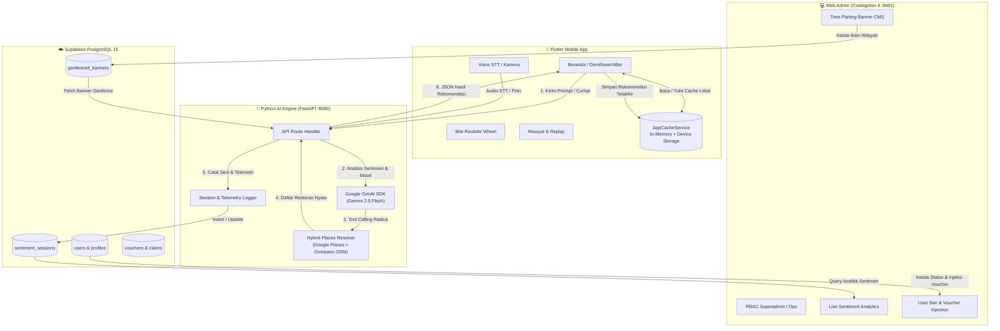
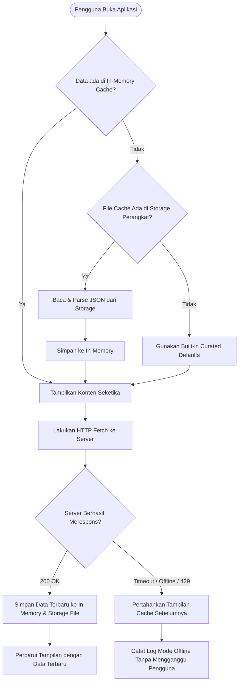
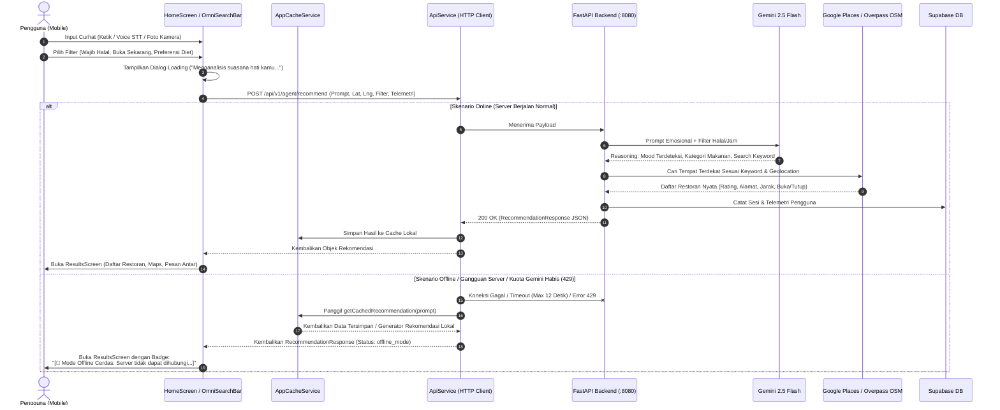
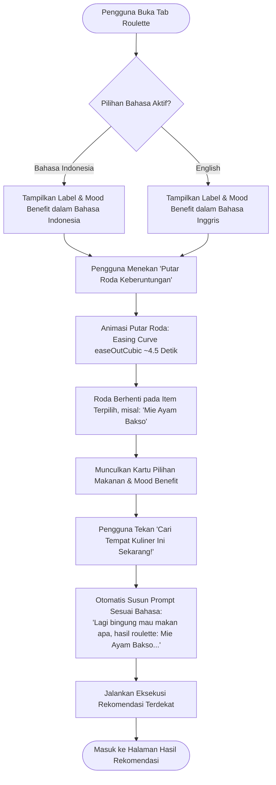
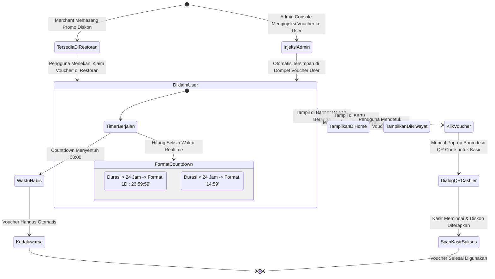
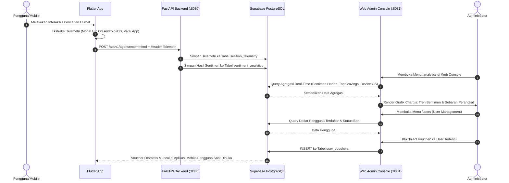

# 🔄 MoodEats — Diagram Alur & User Flow Sistem

Dokumen ini mendeskripsikan seluruh alur sistem (*system workflow*) dan alur interaksi pengguna (*user journey*) pada aplikasi **MoodEats**, mulai dari inisialisasi awal, kurasi sentimen berbasis AI, ketahanan offline, gamifikasi, hingga dashboard operasional.

---

## 📑 Daftar Isi Alur

1. [Arsitektur Global & Alur Data End-to-End](#1-arsitektur-global--alur-data-end-to-end)
2. [Alur Inisialisasi Aplikasi & Dual-Storage Cache](#2-alur-inisialisasi-aplikasi--dual-storage-cache)
3. [Alur Curhat Multimodal & Penalaran Sentimen AI (Online vs Offline)](#3-alur-curhat-multimodal--penalaran-sentimen-ai-online-vs-offline)
4. [Alur Gamifikasi Bite Roulette (Bilingual & Direct Search)](#4-alur-gamifikasi-bite-roulette-bilingual--direct-search)
5. [Alur Riwayat Sesi, Lazy Pagination & Zero-Cost Replay](#5-alur-riwayat-sesi-lazy-pagination--zero-cost-replay)
6. [Alur Mesin Voucher Dinamis (Klaim, Injeksi Admin & Countdown 1D : HH:MM:SS)](#6-alur-mesin-voucher-dinamis-klaim-injeksi-admin--countdown-1d--hhmmss)
7. [Alur Telemetri Mobile & Analitik Sentimen Real-Time di Web Admin](#7-alur-telemetri-mobile--analitik-sentimen-real-time-di-web-admin)

---

## 1. Arsitektur Global & Alur Data End-to-End



---

## 2. Alur Inisialisasi Aplikasi & Dual-Storage Cache

Alur ini memastikan pengguna selalu melihat konten instan tanpa jeda blank screen atau crash saat membuka aplikasi, baik dalam kondisi online maupun saat server tidak dapat dihubungi.



### Komponen Cache:
1. **Banners Cache (`moodeats_cache_banners.json`)**: Menyimpan banner promo wilayah.
2. **Default Menus Cache (`moodeats_cache_default_menus.json`)**: Menyimpan hidangan kenyamanan (*comfort food*) lokal.
3. **Roulette Cache (`moodeats_cache_roulette_items.json`)**: Menyimpan opsi makanan & manfaat suasana hati.
4. **History Cache (`moodeats_cache_history_<userId>.json`)**: Menyimpan sesi pencarian pengguna sebelumnya.
5. **Recommendation Cache (`moodeats_cache_rec_<prompt>.json` & `rec_latest`)**: Menyimpan kartu hasil rekomendasi.

---

## 3. Alur Curhat Multimodal & Penalaran Sentimen AI (Online vs Offline)



---

## 4. Alur Gamifikasi Bite Roulette (Bilingual & Direct Search)



---

## 5. Alur Riwayat Sesi, Lazy Pagination & Zero-Cost Replay

```mermaid
flowchart TD
    OpenHistory([Pengguna Buka Tab Riwayat]) --> FilterDefault[Filter Default: 'Hari Ini' (Today Only)]
    FilterDefault --> FetchBatch1[Fetch Batch Awal (Offset: 0, Limit: 10)]

    FetchBatch1 --> RenderCards[Tampilkan Daftar Kartu Sesi]
    
    RenderCards --> UserAction{Aksi Pengguna?}
    
    %% Aksi 1: Replay Rekomendasi
    UserAction -- Klik Salah Satu Kartu Riwayat --> CheckSavedData{Detail Rekomendasi Tersimpan di Sesi?}
    CheckSavedData -- Ya --> InstantReplay[Buka ResultsScreen Seketika dari Cache Lokal<br/>(0 Token AI, 0 Delay API)]
    CheckSavedData -- Tidak --> ReQueryAI[Kirim Ulang Prompt ke AI Agent]

    %% Aksi 2: Ubah Filter Tanggal
    UserAction -- Pilih 'Pilih Rentang' --> OpenDateRangePicker[Buka Dialog Kalender Material]
    OpenDateRangePicker --> ApplyRange[Filter Data Berdasarkan Tanggal Mulai & Selesai]
    ApplyRange --> FetchFiltered[Fetch Sesi Sesuai Rentang Tanggal] --> RenderCards

    %% Aksi 3: Scroll ke Bawah (Lazy Load)
    UserAction -- Scroll Mendekati Bawah --> CheckMore{has_more == true?}
    CheckMore -- Ya --> LoadNextPage[Panggil API dengan Offset += 10]
    LoadNextPage --> AppendList[Tambahkan 10 Item Baru ke Daftar] --> RenderCards
    CheckMore -- Tidak --> ShowEndNotice[Tampilkan 'Semua riwayat telah dimuat']

    %% Aksi 4: Klik Tab Riwayat saat Berada di Bawah
    UserAction -- Klik Ikon Tab Riwayat --> SmoothScrollUp[Otomatis Scroll Mulus Kembali ke Atas]
```

---

## 6. Alur Mesin Voucher Dinamis (Klaim, Injeksi Admin & Countdown 1D : HH:MM:SS)



---

## 7. Alur Telemetri Mobile & Analitik Sentimen Real-Time di Web Admin



---

## 📌 Ringkasan Status Alur Sistem

| Fitur | Status Alur | Verifikasi Lapangan |
|:---|:---|:---|
| **Inisialisasi & Cache Perangkat** | 🟢 Selesai & Terverifikasi | Diuji cold start & reboot aplikasi |
| **Pencarian Sentimen Multimodal** | 🟢 Selesai & Terverifikasi | Teks, STT suara, dan kamera berfungsi |
| **Resiliensi Mode Offline** | 🟢 Selesai & Terverifikasi | Diuji saat server mati total; UI tetap utuh & kartu lokal tersaji |
| **Bite Roulette Bilingual** | 🟢 Selesai & Terverifikasi | Label & mood berganti instan saat ubah bahasa |
| **Riwayat & Replay Tanpa AI** | 🟢 Selesai & Terverifikasi | Replay instan dari cache sesi lokal |
| **Timer Voucher `1D : HH:MM:SS`** | 🟢 Selesai & Terverifikasi | Ticker countdown berjalan akurat di Beranda & Riwayat |
| **Admin Console & Telemetri** | 🟢 Selesai & Terverifikasi | Data perangkat & sentimen tercatat di dashboard |
