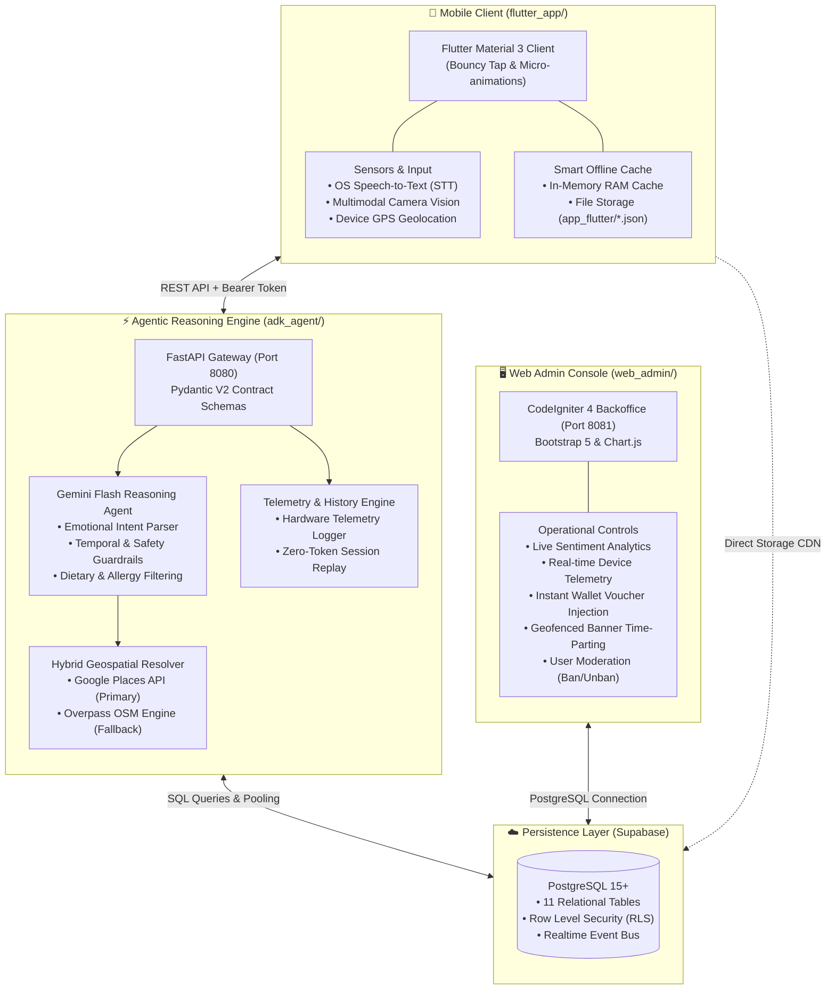

# 🍜 MoodEats — Autonomous Hyperlocal Sentiment Commerce & Culinary Discovery Engine

> **AI Builder Cup 2026 Submission**  
> **Track:** Retail & Commerce: Intelligent Customer and Business Experiences  
> **Target Platform:** Mobile (Flutter iOS & Android), Cloud AI Reasoning (FastAPI), Backoffice Operations (CodeIgniter 4)

MoodEats is an AI-powered hyperlocal conversational commerce platform that transforms raw human emotion and sentiment into instant culinary decisions and physical foot-traffic commerce. Powered by **Gemini Flash Reasoning**, a hybrid geospatial curation engine (**Google Places API + Overpass OpenStreetMap**), interactive decision gamification (**Bite Roulette**), a precision-decay dynamic voucher engine, and a **Smart Offline Cache Architecture**, MoodEats delivers a zero-interruption customer discovery experience even during network drops or API rate-limiting conditions.

---

## 🏛️ System Architecture

MoodEats is built with a production-ready modular architecture decoupling the mobile client, the agentic reasoning engine, operational backoffice management, and the cloud persistence layer:



### Subsystem Breakdown:

| Module | Tech Stack | Port / Platform | Core Responsibilities & Capabilities |
|:---|:---|:---|:---|
| **`flutter_app/`** | Flutter 3.22+ (Dart), Riverpod, Material 3 | Android / iOS / Web | Highly responsive mobile client, native STT, camera multimodal vision, live GPS tracking, precision countdown vouchers (`1D : HH:MM:SS`), dual memory-disk offline cache, full English & Indonesian bilingual toggle. |
| **`adk_agent/`** | Python 3.13, FastAPI, Google GenAI SDK | `http://localhost:8080` | Sentiment reasoning agent, mood-to-flavor mapping, hybrid geospatial resolver (Google Places + OpenStreetMap), device telemetry ingestion, operating hours filter (`only_open_now`). |
| **`web_admin/`** | CodeIgniter 4 (PHP 8.2+), Bootstrap 5, Chart.js | `http://localhost:8081` | Real-time sentiment intelligence dashboard, mobile device telemetry inspector (OS, app version, brand/model), user moderation, direct merchant promo voucher injection, and geofenced banners. |
| **`database/`** | PostgreSQL 15 (Supabase) | Cloud Managed | 11 relational tables managing user profiles, conversational sessions, dietary restrictions, sponsored merchants, claimed vouchers, sentiment telemetry, promo banners, and comfort food catalogs. |

---

## 🌟 Key Innovations & Core Features

### 1. 🧠 Autonomous Sentiment Reasoning & Multimodal Input
- **Natural Language Venting**: The AI decomposes complex human emotional states (overworked fatigue, celebratory joy, late-night burnout, heartbreak) into tailored nutritional and sensory needs (*warm restorative broths, spicy dopamine stimulants, calming comfort sweets*).
- **Native Speech-to-Text (STT)**: Direct voice recording with built-in Quick Voice Suggestions for hands-free discovery.
- **Multimodal Camera Vision**: Snap photos of dishes, physical menus, or receipts for instant nutritional and sentiment pairing via Gemini Vision.
- **Strict Operating Hours Filter ("Open Now")**: One-tap toggle that verifies real-time opening hours to guarantee users never arrive at closed venues.
- **Rigid Dietary & Allergen Safety**: Enforces strict constraints for Halal, Vegan, Vegetarian, Gluten-Free, and custom allergen avoidance.

### 2. 🛡️ Smart Offline Resilience & Persistent Device Cache
- **Dual-Layer Cache Architecture**: Caches raw response data in high-speed RAM and disk storage (`app_flutter/moodeats_cache_*.json`) for instant cold starts.
- **Zero-Crash Network Fault Tolerance**: If the backend is unreachable, network drops, or API rate limits are hit (*HTTP 429 RESOURCE_EXHAUSTED*), the application **never crashes or presents a blank screen**.
- **Offline Capabilities**:
  - Local promo banners and curated comfort food catalogs.
  - Interactive **Bite Roulette** spinning and decision resolution.
  - Complete browsing of past session history.
  - Wallet access to claimed active vouchers.
- **Smart Offline Banner**: An unobtrusive indicator informs users: `[⚡ Smart Offline Mode: Displaying saved local recommendations]`.

### 3. 🎲 Bite Roulette — Indecision Gamification Engine
- **Physics-Based Deceleration**: Realistic lucky wheel physics animation with organic cubic-bezier deceleration curves.
- **Fully Bilingual (EN / ID)**: Instant dynamic localization updates dish names and mood-benefit descriptors across English and Indonesian.
- **Direct Search Shortcut**: A dedicated "Search This Dish Nearby" action connects the selected roulette dish directly to nearby merchants without re-typing.

### 4. ⚡ Intelligent Session History & Zero-Token Recommendation Replay
- **Today-Only Default View**: Prioritizes today's dining intents to prevent cognitive clutter.
- **Date Range Picker & View All**: Enables filtering past discovery sessions across custom date ranges.
- **Lazy Loading Pagination**: Efficient 10-session page batching with smooth loading indicators.
- **Zero-Token Instant Replay**: Re-opens previously generated recommendation cards directly from cached session states without calling the Gemini API again (saving 100% of LLM quota and token overhead).

### 5. 🎟️ Dynamic Voucher Engine & Countdown Timer
- **High-Precision Countdown**: Renders remaining voucher validity in `1D : 23:59:59` format for long-term campaigns and `MM:SS` for flash dine-in offers.
- **Integrated Placement**: Accessible directly from homepage banners and floating badges within the History tab.
- **Cashier QR Code Modal**: Generates instant QR codes and barcodes for cashier scanning at physical partner outlets.

### 6. 📊 Web Admin Console & Real-Time Telemetry
- **Live Hardware Telemetry**: Tracks client device models, OS versions (Android / iOS), and client application versions in real time.
- **Live Sentiment Analytics**: Visualizes daily sentiment velocity, trending food keywords, and emotional distribution graphs.
- **Direct Wallet Voucher Injection**: Administrators can inject targeted promo vouchers directly into specific user accounts.
- **User Moderation Controls**: Instant account suspension (ban/unban) for security and abuse prevention.

---

## 🚀 Setup & Execution Guide

### 1. Prerequisites
- **Node.js** (v18+) & **npm**
- **Python** 3.11+ or 3.13+
- **PHP** 8.2+ (with extensions enabled: `intl`, `mbstring`, `pdo_pgsql`, `curl`)
- **Composer** 2.x
- **Flutter SDK** 3.22+
- **Android Device** or Emulator with USB Debugging enabled

---

### 2. Environment Configuration (`.env`)

Copy the environment template files across each project directory:
```bash
# Root
cp .env.example .env

# Web Admin
cp web_admin/.env.example web_admin/.env

# AI Agent
cp adk_agent/.env.example adk_agent/.env

# Flutter Mobile App
cp flutter_app/.env.example flutter_app/.env
```

Populate your private keys (`GOOGLE_GEMINI_API_KEY`, `SUPABASE_URL`, `SUPABASE_ANON_KEY`, and database credentials) into your local `.env` files.

---

### 3. Database Migration
Initialize the database tables and sample records against your Supabase PostgreSQL instance:
```bash
# Using Python migration runner:
cd database
python migrate.py

# Or via psql CLI:
psql "postgresql://postgres:<password>@<db-host>:5432/postgres" -f run_all.sql
```

---

### 4. Running the AI Agent (FastAPI Backend)
```bash
cd adk_agent
python -m venv .venv

# Activate virtual environment:
# Windows:
.venv\Scripts\activate
# Linux/macOS:
# source .venv/bin/activate

pip install -r requirements.txt
python -m uvicorn main:app --host 0.0.0.0 --port 8080 --reload
```
> Server running at: `http://localhost:8080`  
> Interactive Swagger API Documentation: `http://localhost:8080/docs`

---

### 5. Running the Web Admin Console (CodeIgniter 4)
```bash
cd web_admin
composer install
php spark serve --port 8081
```
> Admin Console running at: `http://localhost:8081`

---

### 6. Running the Mobile Application (Flutter)
```bash
cd flutter_app
flutter pub get

# Launch directly on connected physical device or emulator:
flutter run

# Or build debug APK:
flutter build apk --debug
adb install -r build/app/outputs/flutter-apk/app-debug.apk
```

---

## 📡 Core API Endpoints (`adk_agent`)

| Method | Endpoint | Description |
|:---|:---|:---|
| `POST` | `/api/v1/agent/recommend` | Emotional sentiment extraction, mood-to-flavor mapping, and venue discovery via Gemini Flash & Google Places. Ingests device telemetry & `only_open_now` filter. |
| `POST` | `/api/v1/agent/analyze-image` | Multimodal vision analysis for dishes, menus, or receipts. |
| `GET` | `/api/v1/banners` | Retrieves active promotional banners filtered by geofencing and active hours. |
| `GET` | `/api/v1/menus/default` | Fetches curated comfort food catalog items. |
| `GET` | `/api/v1/roulette` | Fetches randomized dishes for Bite Roulette (bilingual EN & ID). |
| `GET` | `/api/v1/sessions/history` | Retrieves paginated user discovery history (`offset`, `limit`) with date-range filters (`start_date`, `end_date`). |
| `POST` | `/api/v1/users/sync` | Synchronizes user profile details (name, date of birth, dietary preferences, and hardware telemetry). |
| `GET` | `/api/v1/vouchers/my` | Retrieves all active claimed vouchers for the authenticated user. |
| `POST` | `/api/v1/vouchers/claim` | Claims a promotional discount voucher for a specific merchant. |

---

## 📂 Repository Directory Structure

```
mood_eats/
├── README.md                                    # Master project documentation
├── FLOW.md                                      # End-to-end system architecture & user flows
├── moodeats_master_product_requirement_document.md # Master Product Requirements Document
├── database/                                    # Database schema migrations & seeders
│   ├── migrate.py                               # Automated Python migration runner
│   ├── run_all.sql                              # Combined SQL schema script
│   └── 001_extensions.sql ... 011_admin_users.sql
├── adk_agent/                                   # Agentic Reasoning Backend (FastAPI)
│   ├── main.py                                  # Server entry point & route controllers
│   ├── agent/
│   │   ├── moodeats_agent.py                    # Gemini reasoning logic & tool orchestration
│   │   └── tools/places_resolver.py             # Hybrid Google Places & Overpass OSM resolver
│   └── requirements.txt
├── web_admin/                                   # Operational Backoffice Console (CodeIgniter 4)
│   ├── app/Controllers/                         # Dashboard, Analytics, Users, Vouchers, Banners
│   ├── app/Views/                               # Admin Console UI templates
│   └── composer.json
└── flutter_app/                                 # Cross-Platform Mobile Client (Flutter)
    ├── lib/
    │   ├── core/constants/ & localization/     # Design tokens & bilingual EN/ID resources
    │   ├── data/
    │   │   ├── models/                          # Serializable entity models
    │   │   └── services/
    │   │       ├── api_service.dart             # HTTP network layer with auto-caching
    │   │       └── app_cache_service.dart       # Smart Offline dual-storage cache manager
    │   ├── providers/app_providers.dart         # Riverpod global state management
    │   └── presentation/screens/
    │       ├── home/home_screen.dart            # Main discovery dashboard & OmniSearchBar
    │       ├── roulette/bite_roulette_screen.dart # Bite Roulette gamification screen
    │       ├── history/history_screen.dart      # Session history & zero-token replay
    │       ├── account/account_screen.dart      # User preferences & language switcher
    │       └── results/results_screen.dart      # AI recommendation cards & venue details
    └── pubspec.yaml
```

---

## 📄 License & Declaration
Developed by the MoodEats Team. Created exclusively for the **AI Builder Cup 2026** competition.
